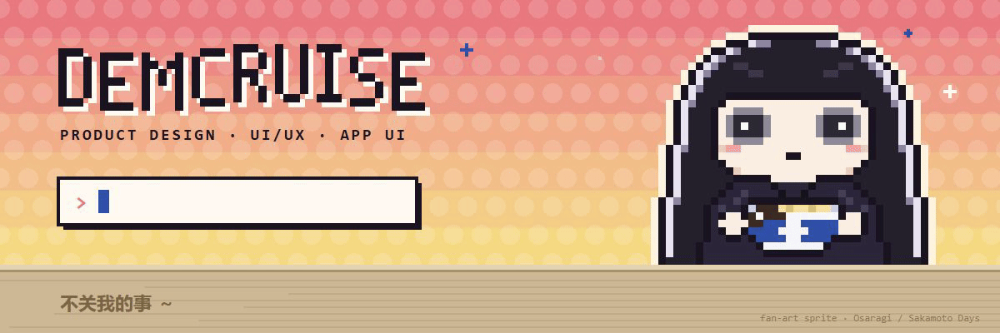

  
  
  
  

### 👾 About me

- 🎨 I own **product design** end-to-end — from framing the problem to the UI that ships.
- 🧭 **UI/UX**: research, user flows, wireframes, high-fidelity prototypes, usability testing.
- 📱 **App UI**: mobile & web interfaces, design systems, components, micro-interactions.
- 📍 Based in **Shanghai** · 不关我的事

### 🧰 Toolbox

### 🛠️ Selected work

| Project | What I designed |
| --- | --- |
| [**mesta-dynamic-pricing**](https://github.com/Demcruise/mesta-dynamic-pricing) | Human-in-the-loop retail pricing UI — approval flows & price-change dashboards |
| [**Mesta-Demand-Forecasting**](https://github.com/Demcruise/Mesta-Demand-Forecasting) | Forecast exploration UI that makes model output readable for planners |
| [**OCTO**](https://github.com/Demcruise/OCTO) | Investment & portfolio app consolidating fragmented data into one view |
| [**Syntera_ERP**](https://github.com/Demcruise/Syntera_ERP) | ERP modules — dense data tables, forms & navigation that stay calm |
| [**daemon-blockint-tech-landingpage**](https://github.com/Demcruise/daemon-blockint-tech-landingpage) | Company profile landing page |

### 📊 Activity

  
  

    

  <picture>
    <source media="(prefers-color-scheme: dark)" srcset="https://raw.githubusercontent.com/Demcruise/Demcruise/output/snake-dark.svg" />
    
  </picture>

  

